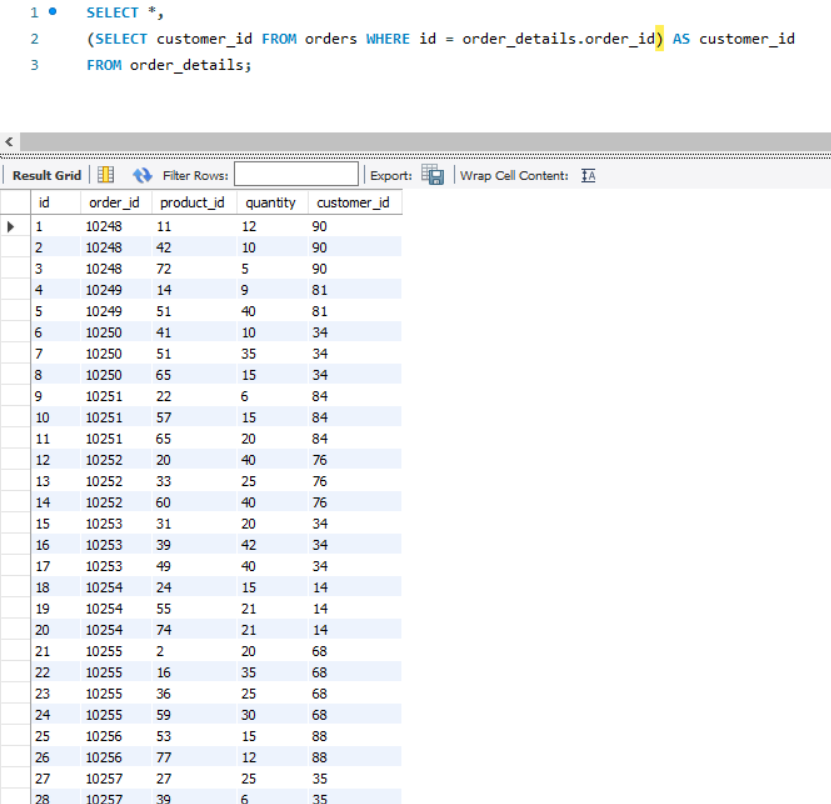
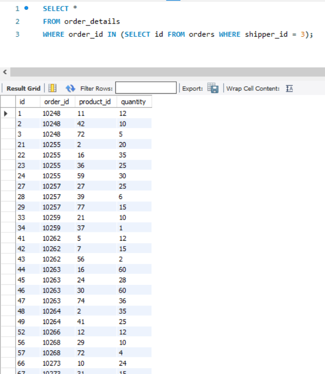
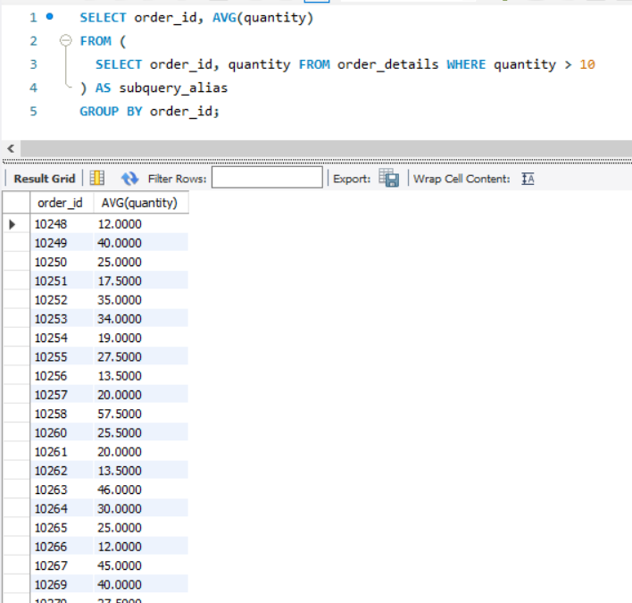
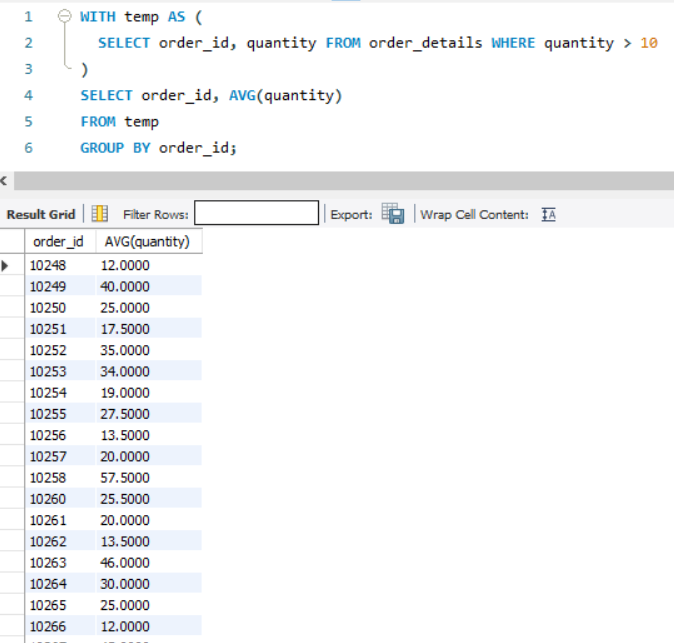
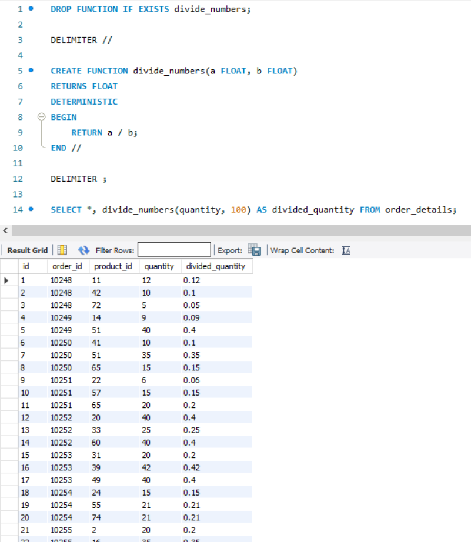

# goit-rdb-hw-05 — Вкладені запити. Повторне використання коду

Домашнє завдання з теми "Вкладені запити. Повторне використання коду": використання підзапитів у SELECT, WHERE та FROM, тимчасових таблиць через WITH, та створення власної SQL-функції.

Обраний підхід: задовольнитися першою отриманою оцінкою.

## 1. Підзапит в операторі SELECT

Для кожного рядка `order_details` виводиться відповідний `customer_id` із таблиці `orders`.

```sql
SELECT *, (SELECT customer_id FROM orders WHERE id=order_details.order_id) AS customer_id
FROM order_details;
```



## 2. Підзапит в операторі WHERE

Вибірка `order_details`, де відповідний запис в `orders` має `shipper_id = 3`.

```sql
SELECT *
FROM order_details
WHERE order_id IN (SELECT id FROM orders WHERE shipper_id = 3);
```



## 3. Підзапит в операторі FROM

Вибір рядків з `quantity > 10`, групування за `order_id` та обчислення середнього значення `quantity`.

```sql
SELECT order_id, AVG(quantity)
FROM (
  SELECT order_id, quantity FROM order_details WHERE quantity > 10
) AS subquery_alias
GROUP BY order_id;
```



## 4. Тимчасова таблиця через WITH

Те саме завдання, що й у пункті 3, реалізоване через CTE (Common Table Expression).

```sql
WITH temp AS (
  SELECT order_id, quantity FROM order_details WHERE quantity > 10
)
SELECT order_id, AVG(quantity)
FROM temp
GROUP BY order_id;
```



## 5. Власна функція з двома параметрами

Функція ділення двох чисел типу FLOAT, застосована до поля `quantity` таблиці `order_details`.

```sql
DROP FUNCTION IF EXISTS divide_numbers;

DELIMITER //

CREATE FUNCTION divide_numbers(a FLOAT, b FLOAT)
RETURNS FLOAT
DETERMINISTIC
BEGIN
    RETURN a / b;
END //

DELIMITER ;

SELECT quantity, divide_numbers(quantity, 2) AS divided_quantity
FROM order_details;
```


